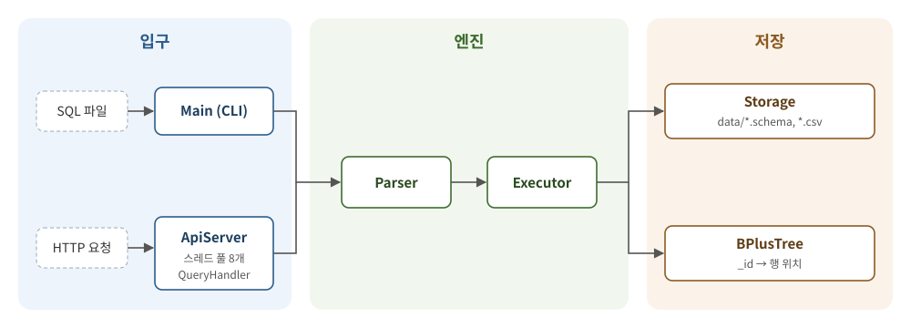

# mini-dbms
Krafton Jungle Week 11-12 | 미니 DBMS 구현 (Java)

<br/>

## 목표
- **Phase 1**: 데이터를 파일에 안전하게 오래 보관하고, SQL로 넣고 조회한다.
- **Phase 2**: 100만 건 이상의 데이터에서도 인덱스로 빠르게 조회한다.
- **Phase 3**: 여러 클라이언트가 API 서버로 하나의 DB를 서로 영향 없이 쓰고, 오류가 나면 원인을 메시지로 받는다.

<br/>

## 개발 기간
| Phase | 기간 |
| --- | --- |
| 1 | 2026.11.14 ~ 11.15 |
| 2 | 2026.11.16 |
| 3 | 2026.11.17 |

<br/>

## 진행 방식
- 가장 작은 단위 하나씩 "결정 → 구현 → 테스트"로 진행했습니다.
- 설계는 팀이 결정했고, AI(Claude Code)는 선택지 정리와 구현 보조에 썼습니다.
- 실제 DBMS(SQLite)를 직접 써 보며 비교했습니다.

<br/>

## 빠른 시작
JDK 17 이상(21 권장)이 필요합니다.

```bash
./gradlew run --args="examples/insert.sql"   # SQL 파일 실행(CLI)
./gradlew server                             # API 서버 (127.0.0.1:8080)
```

설치, 실행 옵션, API 요청·응답 형식, 지원 문법은 [매뉴얼](docs/manual.md)에 있습니다.

<br/>

## 문서
| 문서 | 내용 |
| --- | --- |
| [매뉴얼](docs/manual.md) | 설치, 실행, API, 지원 문법 |
| [주요 개념](docs/concepts.md) | 프로젝션, B+ 트리, 외부 클라이언트, 동시성 기본 개념 |
| [설계 결정](docs/design.md) | 저장, 인덱스, 동시성·락, API 설계의 근거 |
| [시나리오 1: 저장·조회](docs/scenario-1.md) | Phase 1 유저 스토리, 완료 조건, 써 보며 고친 것 |
| [시나리오 2: 인덱싱](docs/scenario-2.md) | Phase 2 유저 스토리, 벤치마크 결과 |
| [시나리오 3: API 서버](docs/scenario-3.md) | Phase 3 유저 스토리, 완료 조건 확인 |

<br/>

## 구조



| 패키지 | 클래스 | 역할 |
| --- | --- | --- |
| `minidb` | `Main`, `TablePrinter` | CLI 입출력 |
| `server/` | `ApiServer`, `QueryHandler` | HTTP 입출력 |
| `parser/` | `Lexer`, `Parser` | SQL 해석 |
| `executor/` | `Executor`, `TableState` | 쿼리 실행, 동시성 제어 |
| `storage/` | `Storage` | 파일 읽기/쓰기 |
| `index/` | `BPlusTree` | `_id` 인덱스 |

> CLI와 API 서버는 **같은 엔진**을 사용

<br/>

## 주요 설계 결정
자세한 근거는 [설계 결정](docs/design.md)에 있습니다.

### 1. 언어: Java
| 후보         | 장점                                                         | 단점 |
|------------|------------------------------------------------------------| --- |
| **Java** | 팀원 모두 읽기 편함, 정적 타입, <br/> `synchronized`·스레드 풀 등 동시성 도구 내장 | 클래스·예외 선언 등 코드 양이 많음 |
| Go         | 문법이 단순, 다중 반환으로 에러 처리가 명확                                  | 팀원이 읽기 어렵고 기간 안에 익히기 어려움 |
| Python     | 코드가 짧고 빠르게 작성                                              | 타입 검사가 약하고 실행 속도가 느림 |

<br/>

### 2. 스키마 형식: JSON
사용자가 **읽기 쉬운 것**을 최우선으로, 필드 이름이 보이는 JSON을 선택함.

ex) `students` 테이블(`name` TEXT, `age` INT)

| 후보 | 예시 | 규칙이 늘어나면 |
| --- | --- | --- |
| **JSON** | `{"columns":[{"name":"name","type":"TEXT"},`<br>`{"name":"age","type":"INT"}]}` | 추가 코드 없이 그대로 처리됨 |
| 띄어쓰기 | `name TEXT`<br>`age  INT` | 따옴표 처리 파서를 직접 만들어야 함 |
| CSV | `name,type`<br>`name,TEXT`<br>`age,INT` | 빈칸이 늘어 읽기 어려움 |
| SQL | `CREATE TABLE students (name TEXT, age INT);` | 사실상 CREATE TABLE 파서를 만드는 일 |

<br/>

### 3. 인덱스: 메모리 B+ 트리
- `_id` → 그 행의 CSV **바이트 오프셋**. 파일의 그 위치로 바로 가서 한 줄만 읽습니다.
- 실행마다 다시 만듭니다. 그래서 조회를 반복할수록 이득입니다.

<br/>

### 4. 동시성: 락 2단계
| 범위 | 방법 |
| --- | --- |
| 스레드 사이 | 테이블별 **배타 락**. 같은 테이블은 하나씩, 다른 테이블끼리는 병렬 |
| 프로세스 사이 | `data/.lock` 파일 락. 서버와 CLI가 같은 `data/`를 동시에 못 씀 |

<br/>

### 5. API: 요청당 SQL 1문장
락을 한 번만 잡으면 되므로 데드락이 생기지 않습니다. 요청은 고정 스레드 8개가 처리합니다.

<br/>

## 성능 비교 (Phase 2)

> 100만 행에서 `_id` 인덱스 조회가 선형 조회보다 **수백 배 이상** 빠름.

| 조회 방식 | 1건당 시간 (머신 1 기준) |
| --- | --- |
| `WHERE _id = k` (인덱스) | 0.38 ms |
| `WHERE num = k` (선형) | 456 ms |

머신별 수치는 [시나리오 2](docs/scenario-2.md#벤치마크-결과-100만-행-팀원-3대-머신)에 있습니다.

<br/>

## 추후 구현 사항 
- **접근 제어**(사용자 인증, 권한): 이번 과제에서는 지원하지 않습니다. `data/` 파일은 OS 파일 권한으로만 보호됩니다.
- **SQL**: 삭제, 범위 조회, 요청 하나에 여러 문장, 트랜잭션
- **인덱스**: `_id` 외 컬럼 인덱스, 인덱스 파일 저장
- **동시성**: 읽기/쓰기 락, 행 단위 락
- **서버**: 대기열 제한
