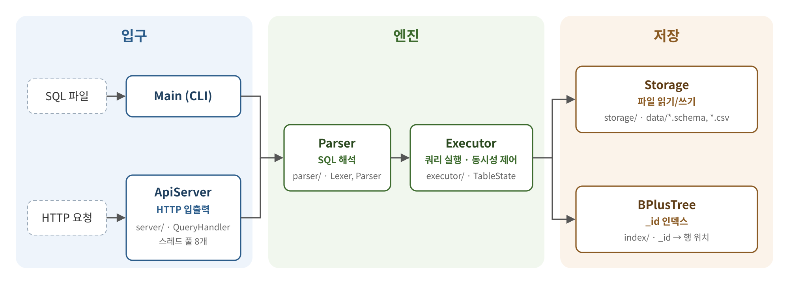

# mini-dbms

[← README](../README.md)

## Java 를 선택한 이유
- 팀원 모두 읽고 코드 리뷰를 할 수 있는 언어
- 동시성에 필요한 도구가 언어와 표준 라이브러리에 들어 있음
- 스레드가 실제로 병렬로 실행되어, 스레드 풀 기반 API 서버를 만들기에 알맞음

 

## 인덱스
인덱스가 없으면 WHERE 조회는 CSV 100만 줄을 처음부터 끝까지 읽어야 함
> 100만 행에서 `_id` 인덱스 조회가 선형 조회보다 **수백 배 이상** 빠름

### 인덱스 성능 비교
| 항목 | 머신 1 | 머신 2 | 머신 3 |
| --- | --- | --- | --- |
| 조회 1건: 인덱스 | 0.38 ms | 0.035 ms | 2.0 ms |
| 조회 1건: 선형 INT | 456 ms | 155 ms | 732 ms |
| 인덱스 / 선형 INT | 1,196배 | 4,420배 | 361배 |

### B+ 트리 리프 값
| 후보 | 결과 |
| --- | --- |
| **바이트 오프셋**  | id 를 찾고, 그 행이 CSV 파일의 몇 번째 바이트에서 시작하는지 기억.   그 위치로 바로 가서 한 줄만 읽음. |
| 줄 번호 | 줄 길이가 제각각, 처음부터 줄바꿈을 세야 함 |
| 행 데이터 자체 | 가장 빠르지만 100만 행이 전부 메모리에 올라감 |

- **파일로 저장하지 않고 메모리에만 보관**, 실행마다 CSV를 훑어 재생성
- **API 서버는 한 번 띄우면 잘 끄지 않기 때문에, 처음에 한 번 만들어 두고 요청마다 재사용해도 된다고 판단**
- 재구축 비용은 조회 1~2번이면 회수

 

## API 서버
> `POST /query` 하나로 SQL 1문장 실행, CLI와 같은 엔진 사용

 

### 하나의 요청 시 처리 흐름
| 단계 | 하는 일 | 실패 시 |
| --- | --- | --- |
| 받기 | JDK `HttpServer` 요청 받음 + 고정 스레드 8개 중 하나가 `QueryHandler` 실행| - |
| 검사 | 경로 `/query`, 메서드 POST, 본문 1MB 이하인지 확인 | 404 / 405 / 413 |
| 해석 | Parser, SQL 정확히 1문장인지 확인 | 아무것도 실행 X, 400 (문법 오류, 문장 0개 또는 2개 이상) |
| 실행 | 쿼리 실행 엔진 `Executor`가 처리   - INSERT : id를 정해 CSV 끝에 쓰고 인덱스에 등록   - SELECT : WHERE id 면 방금 본 인덱스로 한 줄만 읽고, 나머지는 CSV 전부 읽음 | 400 (타입 오류, 없는 테이블·컬럼) / 500 (디스크 오류) |

- `HttpServer`: 스레드 풀 직접 설정 가능
- 엔드포인트 1개: 기존 Parser 재사용
- 요청당 1문장: 락을 한 번만 잡으므로 데드락 없음

 

## 동시성
- 서버에는 요청이 동시에 들어옴
- 스레드 8개가 이 Executor 하나를 같이 씀.
- 두 요청이 같은 테이블에 동시에 INSERT하면
  - 같은 id를 받거나,
  - CSV 한 줄이 섞여 깨지거나,
  - 인덱스가 엉뚱한 위치를 가리킬 수 있음
 
=> 해결 방법 : 테이블마다 락을 하나씩 두기
 

### 문제와 해결

 

| 문제 | 해결                                                                                                                        |
| --- |---------------------------------------------------------------------------------------------------------------------------|
| 스레드 8개가 같은 테이블에 동시 INSERT → `_id` 중복, 행 깨짐 | 테이블마다 인덱스와 다음 번호(_id)를 따로 관리                                                                                              |
| 다른 테이블 락을 잡은 두 스레드가 같은 `HashMap`에 동시 `put` | 관리 객체를 `ConcurrentHashMap`으로 만들어 두 요청이 동시에 접근해도 테이블당 상태 객체 하나만 생성됨.   `synchronized` 로 락을 걸고, 락을 쥔 요청만 테이블을 읽고 쓸 수 있음 |

- **결과 : 같은 테이블에 온 요청은 한 번에 하나씩, 서로 다른 테이블에 온 요청은 동시에 처리됨**
- 테이블 락: 상태(인덱스, 다음 `_id`, CSV)가 전부 테이블 단위로 나뉨
- **파일 락** : 서버를 켠 채 CLI 실행 시, 서로 다른 두 프로그램이 같은 파일을 씀. Java 락은 프로그램 하나 안에서만 통하기 때문에, `data/.lock` 파일 락 추가, 못 잡으면 바로 종료
- 행 락 불필요: INSERT만 있어 한 번 쓴 행은 불변, 충돌 지점은 B+ 트리 전체
- 검증: `ExecutorTest` 8스레드 동시 INSERT에서 `_id` 중복·행 깨짐 없음

 

## SQLite와 비교

| 항목 | mini-dbms | SQLite | 이유 |
| --- | --- | --- | --- |
| 스레드 동시성 | 테이블별 배타 락(읽기끼리도 하나씩) | 읽기 동시에·쓰기 하나(WAL이면 읽기와 쓰기 동시) | 처리할 것이 적은 배타 락 선택 |
| 프로세스 동시성 | `data/.lock`, 못 잡으면 바로 종료 | 파일 락, 기다리거나 busy 오류 | 한 프로세스만 허용 |

- 읽기/쓰기 락: SELECT가 많을 때 유리하지만, **첫 SELECT가 인덱스를 만들며 상태 변경 → 읽기 락을 쥔 채 쓰기 락 요청 시 데드락**
- 락 잡는 곳이 한 군데라 추후 변경 비용 작음

> 데드락 위험과 구현 기간을 고려해 읽기/쓰기 락 대신 단순한 배타 락 선택
